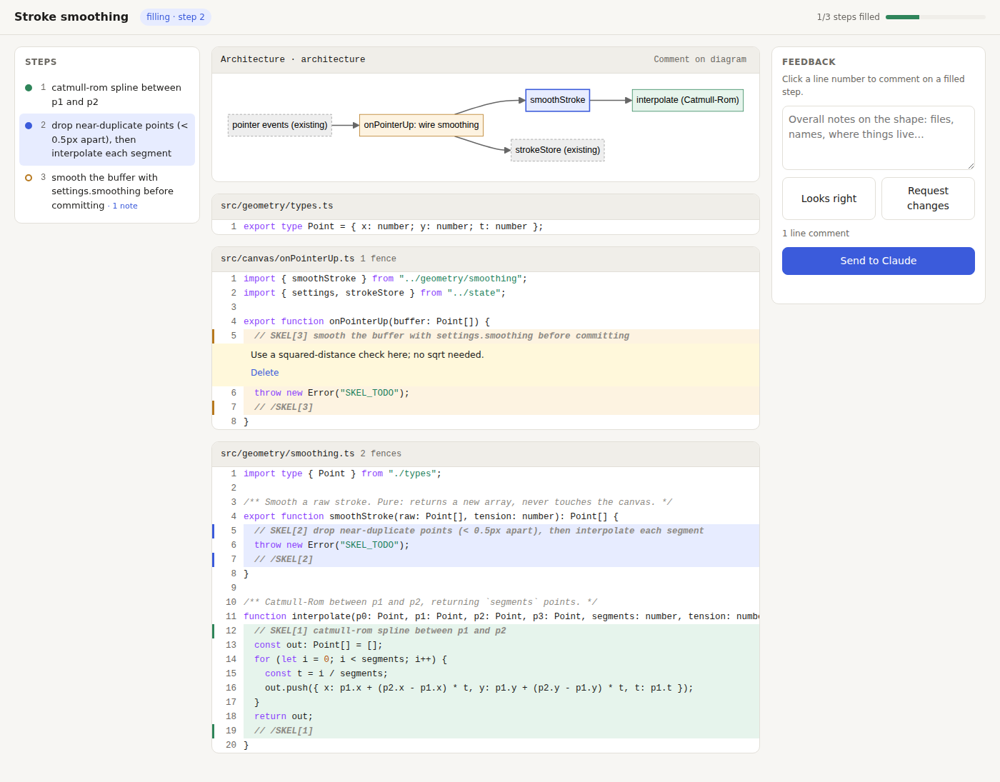

# skeleton-skills

**Write the plan as code. Review the plan's shape. Then fill it in one fenced step at a time.**

Two Claude Code skills and a small CLI that bring back the feeling of building with an AI pair one function at a time, with strong opinions about where code lives:

1. **`/skel:skeleton`**: Claude writes the feature as a *skeleton*: real files, real types and signatures, real wiring, plus an architecture diagram. Every body is an empty, fenced stub. You review the skeleton in a local page, comment on lines or on the diagram, and approve.
2. **`/skel:skeleton-fill`**: Claude fills one step at a time (or `all` of them), but **only inside the fences**. Each step's code is written by a restricted `skel:skeleton-filler` subagent with no shell and no Write, a `PreToolUse` hook checks every edit, and each step is checked against a snapshot of the skeleton you approved, so a signature change or a new file can't slip in unasked: it comes back to you as a skeleton change.



## Why

A prose plan says what will happen. A skeleton *is* what will happen: the file layout, the names, what calls what, what's pure and what has side effects. Most architecture mistakes from an agent happen at exactly that level, and in a skeleton they're cheap to fix because there's no logic to throw away yet. Once you've approved the shape, each fill is a 5–30 line diff inside a slot you designed, small enough to actually read.

## Markers

```ts
/** Smooth a raw stroke. Pure: no canvas access. */
export function smoothStroke(raw: Point[], tension: number): Point[] {
  // SKEL[2] drop near-duplicate points (< 0.5px apart), then interpolate()
  throw new Error("SKEL_TODO");
  // /SKEL[2]
}
```

- `SKEL[id] <title>` opens a fence and `/SKEL[id]` closes it. Each marker is on its own line, behind any comment prefix (`//`, `#`, `--`, `<!--`, …).
- A fence whose body contains `SKEL_TODO` is pending; otherwise it's filled. Progress is read from the code, so there's no status file to drift out of date.
- One id can fence several places (an implementation and its test).
- Ids sort naturally (`1`, `2`, `2.1`, `10`) and set the build order.
- The scan (and the gate) skip tool and build directories wherever they appear: `node_modules`, `.git`, `.claude`, `.skeleton`, `dist`, `build`, `out`, `coverage`, `target` and friends. Fences under a directory with one of those names are ignored, so keep skeleton code elsewhere. The names match as spelled on disk: on a filesystem that ignores case (macOS, Windows, WSL's `/mnt/c`) an edit to `.Claude/...` is an edit to `.claude/`, while a real `Build/` folder is code.
- A file you `skel track` under one of those directories is context only. It's shown on the page and recorded at approve (so editing it during the fill is drift), but its fences are never steps: `status`, `done` and `finalize` ignore them, and the gate won't let a step be "filled" there.

## Architecture diagrams

Mermaid files in `.skeleton/diagrams/*.mmd` render above the code. Nodes with the id `step_<id>` (`step_2_1` for step `2.1`) are colored by status (pending, filled, active), and clicking one jumps to its fence. You can comment on a diagram as a whole.

## Install

skel ships as a Claude Code plugin, `skel` from the `skeleton-skills` marketplace (this repository). The plugin brings the two skills (`/skel:skeleton`, `/skel:skeleton-fill`), the `skel:skeleton-filler` subagent and the three hooks. A plugin can't ship permission rules, so a small `skel install` step in each project adds the deny rules. You still run that step, and any recovery, from a clone of this repository: the plugin doesn't put a `skel` command in your terminal (an npm package may come later).

```bash
# 1. A clone for the terminal CLI. Keep it at a stable path, outside your projects.
git clone https://github.com/mitchjablonski/skeleton-skills ~/tools/skeleton-skills

# 2. The plugin, at local scope (only you, only this project) or project scope (shared via the
#    committed .claude/settings.json; each collaborator still installs it). Run in the project.
cd /path/to/your/project
claude plugin marketplace add mitchjablonski/skeleton-skills --scope local
claude plugin install skel@skeleton-skills --scope local

# 3. The deny rules, then restart Claude Code.
node ~/tools/skeleton-skills/bin/skel.mjs install
```

`claude plugin install` defaults to **user scope**, which runs skel's hooks in every project you open. skel recommends local or project scope. It doesn't refuse a user-scope install, but `skel install` and `skel status` warn about one.

`skel install` adds Claude Code permission **deny** rules to `<project>/.claude/settings.local.json` for the tool's own state: the project's `.skeleton/` state and skel's state dir (`$XDG_STATE_HOME/skel`, else `~/.local/state/skel`, or `%LOCALAPPDATA%\skel` on native Windows), plus the old `~/.config/skel` location it migrates from (see [Security model](#security-model)). It records which rules it added, and the project's Stop mode, in skel's state dir, outside the project. It merges into what's there: your settings and rules are kept, a re-run changes nothing (the file isn't even rewritten), and it refuses a symlinked or unparseable settings file rather than write through it or overwrite it. It prints the exact, quoted `node ".../bin/skel.mjs"` path to use from a terminal.

The Stop hook's mode is per project: `skel install --notify-only` makes drift a notice only; `skel install --block` (or no flag, the default) sends Claude back once per unchanged drift report.

Plugin versions are pinned per release (`version` in `.claude-plugin/plugin.json`), so you stay on a release until you update it yourself (`claude plugin update skel@skeleton-skills`, then restart). Third-party marketplaces don't auto-update by default; leave it that way for now.

To remove skel from a project: `node ~/tools/skeleton-skills/bin/skel.mjs uninstall` takes out the deny rules install added (and, for a legacy install, its hooks and copies) and nothing else: a rule you already had, even an identical one, survives install and uninstall. It lists any rule shaped like skel's that it left in place because this install didn't add it, and leaves `.skeleton/` and its `.gitignore` line for you. It doesn't touch the plugin: `claude plugin uninstall skel@skeleton-skills --scope local` (or the scope you used) does that.

### Developing skel

To run a working copy, add the clone as a local-path marketplace: `claude plugin marketplace add /path/to/skeleton-skills --scope local`, then install as above. A plugin from a local-path marketplace loads **in place** from the clone, so edits apply at the next session or `/reload-plugins`, with no version bump. `claude --plugin-dir /path/to/skeleton-skills` loads it for one session instead, and silently overrides an installed copy with the same name.

### Upgrading from a pre-plugin install

Earlier versions copied the skills and the filler into `.claude/skills/` and `.claude/agents/` and wrote the hooks into `.claude/settings.local.json`. Claude Code doesn't merge a settings hook with a plugin's copy of it, so with both, every hook runs twice (the stricter verdict wins, but it's slower, and each Stop runs twice). To move:

1. Install the plugin (step 2 above).
2. Outside a fill, run `skel install` from your clone (step 3). Once the plugin is positively in place for the project, it removes skel's hooks from `.claude/settings.local.json` (every form any version wrote, from any clone; your own hooks, shared matchers and their metadata stay) and the skill and agent copies that are byte-for-byte what a release of skel installed. A copy you changed stays, and install names it. A Stop hook's `--notify-only` carries over to the project's Stop mode.
3. Restart Claude Code, then check `/hooks`: skel's PreToolUse, Stop and ConfigChange hooks should each appear once, from the plugin.

In a linked git worktree, Claude Code keeps local settings in the main checkout: a `--scope local` install from the worktree writes `enabledPlugins` there and records the worktree as the install's project. Run `skel install` in the main checkout; it matches the worktree's install record to it (two worktrees' records for one checkout are ambiguous, and keep the old hooks).

`skel install` keeps the old hooks and copies, with a warning naming why, when it can't see positive evidence that the plugin's hooks would load: the plugin isn't enabled for the project (an explicit `false` anywhere that outranks the `true` counts), a settings file doesn't parse as a JSON object, the install record or the marketplace's declared source for skel is missing, ambiguous or leaves the marketplace, the copy that would load (the declared folder for a local-path marketplace, and the installed copy) lacks the manifest or the hooks, managed policy (`allowManagedHooksOnly` without a managed enable, a blocked marketplace), `disableAllHooks`, another enabled plugin named `skel`, no install record for this project, or a plugin root whose manifest or `hooks/hooks.json` doesn't carry skel's three hooks. It never removes them during a fill, including a fill in a skeleton below the project. `skel uninstall` likewise removes only unmodified copies. It refuses to choose when the old Stop entries carry both `--block` and `--notify-only`; re-run with the flag you want. It only ever edits `.claude/settings.local.json`; skel hooks in `.claude/settings.json` or your user settings are reported, not removed. Even a clean check is only what's on disk: it can't show what a running session loaded, hence step 3. `skel status` and the Stop hook (once a session) warn while hooks are registered twice.

`skel install --legacy` still does the old full install (copies, hooks and rules), for one more release, if you can't use the plugin (for example under a managed `strictKnownMarketplaces`). Existing settings that run `bin/skel-hook.mjs`, `bin/skel-stop.mjs` or `bin/skel-config-hook.mjs` from a clone keep working.

### What a plugin changes about the guarantees

Installing skel as a plugin changes how you get and update it, not what it guarantees. **Disabling or uninstalling the plugin, or reloading plugins after a change to `enabledPlugins`, removes the drift guard and the settings guard, even mid-fill.** Plainly:

- **`/reload-plugins` after a disable unloads it.** `claude plugin disable` writes `enabledPlugins: false` and fires `ConfigChange`, which skel blocks during a fill, but an explicit `/reload-plugins` then reloads without the plugin (probed on Claude Code 2.1.318). The guard doesn't survive that.
- **A restart loads whatever the settings say.** `ConfigChange` holds a change back from the *running* session; it doesn't stop the write to disk or the next start. The switch is one boolean in `settings.local.json` (local scope) or the committed `settings.json` (project scope).
- **Off switches the guard doesn't see:** `claude plugin disable`/`uninstall` from another terminal (at the next start or reload), `disableAllHooks`, `--setting-sources`, a `--plugin-dir` copy with the same name, another enabled plugin named `skel`.
- **Managed policy wins:** `allowManagedHooksOnly` blocks plugin hooks the policy doesn't enable, a managed `false` blocks the plugin, and marketplace restrictions can prevent the install. Policy changes can't be blocked.
- **Updates mid-session:** hooks keep the old version's path until `/reload-plugins` or a restart.
- **The plugin's files aren't protected.** The cache under `~/.claude/plugins` is yours to write, and a local-path install *is* your clone. A plugin is a way to get skel, not a security boundary.

Recovery never depends on the plugin: run the clone's `node ".../bin/skel.mjs"` from a terminal (or Claude Code's `!` shell mode), whether the plugin is disabled, uninstalled or mid-update.

### WSL: where the plugin runs from

A plugin installed from GitHub is copied into `$CLAUDE_CONFIG_DIR/plugins/cache/...` (default `~/.claude/plugins`, or `CLAUDE_CODE_PLUGIN_CACHE_DIR`). Under WSL, `~` is the Linux home, so the code runs from the Linux filesystem even when your project is on `/mnt/c`. On one machine that cut a Stop check from about 235 ms to 138 ms (#40); loading code across `/mnt/c` is the slow part. A local-path marketplace runs **in place**, so a dev install from a `/mnt/c` clone gets no speedup; nor does a `CLAUDE_CONFIG_DIR` or cache dir pointed at `/mnt/c`. Native Windows isn't affected. The init line of `claude -p --output-format stream-json --verbose` shows each plugin's `path` if you want to check yours.

### Upgrading: skel's state moved

skel's trusted stores used to live in `$XDG_CONFIG_HOME/skel` (else `~/.config/skel`). They are state, not configuration, so they now live in `$XDG_STATE_HOME/skel` (else `~/.local/state/skel`), or `%LOCALAPPDATA%\skel` on native Windows. `XDG_STATE_HOME` is honoured on every platform when it is an absolute path, and `XDG_CONFIG_HOME` now only says where the old location is. `.skeleton/state.json` stays in the project.

A project with records in the old location keeps using them until you move them, because the deny rule your running session has loaded names that location, and skel can't see what a session has loaded. A project with no old records uses the new location from the start. To move a project's records:

1. Run `skel install`, with the same environment. It adds the deny rule for the new location and keeps the one for the old. In a linked git worktree, Claude Code loads settings from the main checkout, so run it there.
2. Restart Claude Code, so the session loads the new rule. A session mid-fill won't pick it up: the `ConfigChange` guard holds settings reloads during a fill, and a held reload isn't retried when the fill ends.
3. Outside a fill, run `skel migrate` in the project. `skel migrate --dry-run` lists what it would do with each file and changes nothing. To move a project that's mid-fill, finish it, or run `skel reshape` first, which discards the approval so you have to give it again.

`skel status` and the `Stop` hook (once a session) remind you until a project has moved, and also whenever the settings Claude Code would load have skel's hook but no rule for the new location, even with no old records. Nothing else moves records: not `install`, not a hook, not an ordinary command. `skel migrate` refuses during a fill, and if those settings lack the rule. In a linked git worktree that means the main checkout's settings. The hook asks you before an agent can run it, but that ask is all there is under `bypassPermissions`, which skips it, so an agent in that mode can run `skel migrate` itself. skel can't check what your session has loaded, so steps 1 and 2 are yours to do first.

All the records move together: the approved-skeleton record, the rendered review versions, the serve sessions, install's ownership record, the settings notice and the Stop delivery cache. Each is checked first. skel copies the records, writes a marker in the old dir (`<hash>.migrated`), then deletes the old files. The marker is the commit point and stays: without it skel reads the old location, and with it the new one, so a crash leaves one whole location in use, and running `skel migrate` again finishes the job. A file that turns up in the old dir after that, from an older skel still running, is ignored and reported by `skel status`. `skel migrate` removes old files only if the new location holds the same bytes; any other stays until you delete it. The markers keep the old dir in place. Once you have no older skel around, you can delete it. Another project's files stay there until that project migrates. Ephemeral `.lock` files are not migrated. It is safe for two skel processes to run at once.

If a project's old records can't be moved, `skel migrate` moves none of them and overwrites nothing, and the project keeps using the old location. It names the files: an old file that is corrupt or doesn't belong to the project, or a file in the new location that doesn't match the old one. That last one is refused because the new location has had no deny rule: a file there may not be skel's, so skel won't trust it. Follow what it says, then run it again. Deleting a snapshot record means re-approving; `done` and `finalize` refuse without one. Malformed or conflicting advisory payloads do not refuse a move: a corrupt settings notice or malformed/oversized Stop delivery cache is dropped, and a valid old advisory record replaces a differing one in the new location. I/O and path errors can still refuse migration, including when reading advisory files.

**A gap to know about.** A project using the new location, in a session that has loaded only the old rule, has no hard deny on its records until that session restarts. An agent's file tools can reach them through a symlink inside the project, or directly under `bypassPermissions` or `auto`. skel can't tell a record written that way from its own. A project with no old records starts out like this, and so does any project once it has moved. `skel status`, the `Stop` hook and `skel approve` warn when the settings on disk lack the rule, but none of them can see that a session hasn't loaded a rule that's on disk, so restart after `skel install`.

**A review server from before this change has to restart.** It only ever reads the old location, so after a move its page would report a missing approval record while the CLI says clean. `skel migrate` stops one it can verify as this project's and says so, and `skel serve` replaces one when you next run it; a server it can't verify is left alone, so stop that yourself. A current server follows the move.

Changing `XDG_CONFIG_HOME` or `XDG_STATE_HOME` later doesn't migrate anything: skel looks only where they point now, so re-run `skel install` after a change.

**Feedback ordering lock recovery.** Send, feedback draining and approval share `.skeleton/feedback/.order-lock` so accepted notes cannot race approval. `skel status` reports a present lock (also as `feedbackLockNotice` in `--json`); presence does not mean it is stale. Retry after the active operation finishes. If a crash left the lock behind, stop all skel servers and commands, then remove only that empty lock directory from an external terminal and retry. Skel never expires or automatically deletes this authority lock. Do not remove the feedback queue or approval records to recover it.

## The loop

```
/skel:skeleton add stroke smoothing to the canvas
   → skel init, writes stubs + diagram, `skel serve` → live read-only page
   → you comment / request changes / approve in the page
   → Copy feedback for Claude → paste into chat
   → skel approve --reviewed <v> (Claude Code asks you to allow it; <v> is the "Reviewed skeleton
                                  version" line you pasted, and approve refuses if the skeleton
                                  changed since the version you reviewed)
/skel:skeleton-fill       (one step, then stop)
/skel:skeleton-fill all   (every step, still fenced)
   → skel next → your opinion → skeleton-filler edits inside the fence → tests → skel done (page reloads)
   → a structural change? Claude stops and proposes it → you reopen it → skel reshape → re-review
   → skel finalize          (strips the markers)
```

The default is a **live read-only page**: code and step status update automatically, and you can add line comments, diagram comments and overall notes. Use **Copy feedback for Claude** and paste it into chat. Claude waits for your chat reply. The server accepts no feedback POSTs in this mode.

For one-click Send, explicitly opt in with `skel serve --send`. Claude then reads `skel feedback --wait 110` during review and `skel feedback` after fills. This enables the feedback POST endpoint, protected by Host/Origin checks and the review token. Switching between `skel serve` and `skel serve --send` restarts the verified server in the requested mode; open tabs follow the switch and reload by themselves. Stop it with `skel serve --stop` when finished.

For no HTTP listener, use `skel review` to generate a static HTML file, then regenerate and refresh after changes. All modes use the same permission request for approval when the hook is loaded; permission modes and integrations determine whether a human answers. Read-only removes the feedback input endpoint, not the read surface: the live page still serves your source to anything holding its token (see [Security model](#security-model)). Mermaid still loads from the pinned CDN in every mode.

**Open the whole URL.** `skel serve` prints `http://127.0.0.1:PORT/#t=<token>`, and the page needs the part after `#`. Run `skel serve` again at any time: it reuses the running server and prints the same working URL. A server started by an older skel, whose reads don't need a token, is replaced instead; reload any tab still open on it, using the new URL. So is any server that doesn't pass that check in time, even a healthy one under load: it gets a new token, and open tabs lock until they have the new URL. If the server was stopped or crashed, its next start has a new token, on the same port. An open tab says its link has expired and stops updating; what's on screen, Copy and your notes all keep working. Open the new URL, in that tab or another, and that tab picks it up. Unsent notes stay in the browser and survive all of this.

## CLI

| Command | |
|---|---|
| `skel init "<title>" [--gate ask\|deny] [--force]` | Start a skeleton (`.skeleton/state.json`); won't replace one in progress without `--force` |
| `skel track <file…>` | Include unfenced skeleton files (e.g. new types) in the review; must be inside the project |
| `skel status [--json]` | Phase, active step, each step's status, and diagram nodes that match no step |
| `skel serve [--port N] [--send] [--stop]` | Default: live read-only review; copy feedback into chat. `--send` enables direct feedback delivery. Prints the page's URL with its token (`#t=…`). Reuses a server in the same mode, and prints the same URL; uses a stable port per project |
| `skel review` | Static `.skeleton/review.html` with no HTTP listener; copy feedback into chat |
| `skel feedback [--wait S]` | Send-mode only: print and archive the human's feedback (waits up to 110s; prints `NO_FEEDBACK` otherwise, `READ_ONLY` at once for a read-only server, or `NO_SERVER` when none has answered for 10s) |
| `skel approve [--reviewed V]` | Enter the fill phase and record the approved skeleton. When the hook is loaded, it requests permission; human confirmation depends on Claude Code's mode and approval integrations. Refuses, with a diff, if the skeleton isn't the version you last reviewed: `--reviewed` names it from the feedback you pasted (else your latest send in Send mode, else the version the review page last rendered, which catches only edits made after it). Also baselines the reviewable source set and prints its counts, policy and exclusions; refuses, naming the file, if discovery fails or a member can't be baselined |
| `skel reshape` | Back to skeleton review (also asks you) |
| `skel next` / `skel start <id> [--force]` / `skel done` | Run steps. `--force` abandons an unfinished step or reopens a filled one. `done` refuses on drift from the approved skeleton or a change to the source baseline |
| `skel finalize` | All filled and no drift: strip the markers |
| `skel hook` | The `PreToolUse` scope gate |
| `skel stop-hook [--notify-only|--block]` | The `Stop` drift check (the plugin runs `bin/skel-stop.mjs`; without a flag it uses the project's mode from `skel install`) |
| `skel migrate [--dry-run] [dir]` | Move a project's records from the old config dir to the state dir, outside a fill ([Upgrading](#upgrading-skels-state-moved)) |
| `skel install [--notify-only\|--block] [dir]` | Add the deny rules and the project's Stop mode; migrate an older install's hooks and copies once the plugin is in place ([Install](#install)) |
| `skel install --legacy [dir]` | The pre-plugin install: skills, filler, hooks and rules written into the project's `.claude/` (one more release) |
| `skel uninstall [dir]` | Remove what install added (not the plugin) |

**Gate modes:** `ask` (default) sends an out-of-fence edit to you for a yes or no. Saying yes lets the edit land, not the step finish: it is drift from what you approved, so `skel done` and `skel finalize` refuse until you `skel reshape` and approve the new shape. `deny` refuses it outright, so Claude must propose a skeleton change.

## The filler subagent

`/skel:skeleton-fill` splits each step in two. The main conversation runs the loop: `skel serve`, `skel next`, your opinion on the approach, the tests, `skel done` and `skel feedback`. The code edit goes to `skel:skeleton-filler`, a [Claude Code subagent](https://code.claude.com/docs/en/sub-agents) whose `tools` are only `Read, Grep, Glob, Edit, MultiEdit`, with `Bash`, `PowerShell`, `Monitor`, `Write`, `NotebookEdit` and `Agent` also denied. The main conversation hands it the fence bodies from `skel next`, the step's contract, the agreed approach and the test to satisfy. The filler edits inside the fence and returns a short report: `filled`, or `blocked` with the skeleton change it needs. It can't run the tests, so when they fail the main conversation sends the output back to it.

**Why:** the hook can only pattern-match shell commands, so arbitrary Bash is the hole in the fence. The agent that writes the step's code has no shell, so for that agent every change goes through Edit, where the hook judges the result exactly. It also can't create a file without you allowing it (Write is removed, and an Edit that would create a file goes to you), can't spawn agents, and starts without your conversation, only with the step's brief.

**Trade-offs:**
- An extra subagent hop per step: a little more latency and tokens, and the filler re-reads the code around the fence.
- The filler can't run anything. It can't check its own work, so a failing test is a round trip, not a quick local fix.
- The main conversation still has a shell, and the skill asks it not to write fence code itself. That rule is an instruction, not something the hook enforces. The filler narrows who writes the code; it doesn't take the shell away from the session.
- MultiEdit is a legacy tool name in current Claude Code (Edit covers it). It's listed for older versions; Claude Code only refuses a subagent when *no* entry in its `tools` resolves.

## Security model

The fence is a **drift guard for a cooperative agent**: it keeps an agent that means well from quietly widening its own scope. It is not a sandbox against a hostile one, which could always write files from a shell.

### Which layer enforces what

| Layer | Set up by | Enforces | Doesn't cover |
|---|---|---|---|
| **Claude Code permission deny rules** | `skel install` | The agent's Edit, Write, MultiEdit and NotebookEdit calls can't write `.skeleton/state.json`, `serve.json`, `review.html`, `feedback/` or `feedback-history/`, or anything in skel's state dir or the old config dir (`Edit(//<dir>/skel/**)`: the approved-skeleton records, rendered review versions, serve sessions and install's ownership records). Nor can Bash commands Claude Code recognises as file writes (`> file`, `tee`, `sed -i`, …). Claude Code checks deny rules itself, whatever a hook returns (a hook's `allow` can't lift them), in every permission mode including `bypassPermissions`, and offers no prompt. The settings file is a Claude Code protected path, so outside `auto` and `bypassPermissions` the agent can't quietly delete the rules either | A script or interpreter that opens files itself (`node -e …`, `python …`). Nested `.skeleton/` directories. A state dir other than the one install resolved (`XDG_STATE_HOME` changed since). A session started where Claude Code doesn't load the project's settings file ([below](#start-claude-code-at-the-project-root)) |
| **Bash sandbox** (optional) | You (see below) | OS-level: the same deny rules become write denials for every sandboxed shell command and its child processes, scripts included | The fence: sandboxed commands can still edit your code. The built-in file tools (the deny rules cover those). Excluded commands, and unsandboxed retries you approve |
| **`PreToolUse` hook** (`skel hook`) | The plugin (or `skel install --legacy`) | The fence itself: an edit during a fill must leave everything outside the active fence unchanged. Asks before `approve`, `reshape`, `init --force`, `finalize`, `git clean -x` and `git stash -a`. Asks for edits to any `.skeleton/` at any depth and for Bash commands that name it, and likewise for edits into skel's state dir or the old config dir from any project and for Bash commands that name them (defence in depth behind the deny rules) | Arbitrary Bash that doesn't name its target (a config path built in a variable included), hook startup failures outside an enrolled fill (a product module that fails to import denies during a fill), a launcher syntax error, a broken `node` or a hanging import, and, like the deny rules, a session that doesn't load the project's settings file |
| **`Stop` hook** (`bin/skel-stop.mjs`) | The plugin (or `skel install --legacy`) | At the end of every Claude turn during a fill, `done` and `finalize`'s drift check on the skeleton's own files (fenced and tracked), reported to you as a `file:line` diff. On unchanged drift, Claude continues once per approval to fix it or propose a reshape, then later prompts and sessions only notify. `--notify-only` opts out ([below](#details)) | A file that newly gains fences, and the rest of the source baseline: both left to `done`, because rereading them every turn would cost seconds on a large project. It runs only when a turn ends, and fails open |
| **`skel:skeleton-filler` subagent** | The plugin (or `skel install --legacy`) | The agent that writes each step's code has only `Read, Grep, Glob, Edit, MultiEdit`: no shell, no Write, no spawning agents, so every change it makes goes through Edit, where the hook judges the result exactly (see [The filler subagent](#the-filler-subagent)) | The main conversation still has a shell; the skill asks it not to write fence code itself, but nothing enforces that |
| **Snapshot check at `done`/`finalize`** | Built: `skel approve` records it; `done`/`finalize` verify | Any drift outside the fences from the approved skeleton, and any edit, new file or deletion in the source baseline, however it was made (Edit, Bash, a script) ([below](#details)) | What the discovery policy leaves out (unless tracked), fence bodies, and a record in skel's state dir rewritten by a script or interpreter (the deny rule and the hook stop the file tools and the shell writes they recognise, not `node -e …`) |

The deny rules are listed path by path, not as `.skeleton/**`, so that `.skeleton/diagrams/` (which the agent writes during `/skeleton`) stays writable: Claude Code's `!` carve-outs can't reopen a directory inside one a rule blocks as a whole. They use only `Edit(...)`, because Claude Code checks every file-writing tool against `Edit` rules and never matches a `Write(path)` rule, and they avoid wildcards other than a trailing `/**`, the only kind the sandbox honours on Linux and WSL2. They name the project by its absolute real path (`Edit(//home/you/proj/.skeleton/state.json)`; on Windows `C:\proj` is written `//c/proj`, the POSIX form Claude Code matches). A single leading `/` would anchor at the session's primary working directory, not the project, so a Claude session started in a subdirectory would guard `<subdir>/.skeleton` and miss the real state. Moving or renaming the project means re-running `skel install`, and install from the same side (Windows or WSL) you run Claude Code on, since the two spell paths differently. The rules for the old path stay in the settings file until you remove them by hand: install and uninstall list them as left in place but never delete a rule they didn't add. A rule is a gitignore pattern, so install backslash-escapes `[ ] * ?` in the path (`( ) { }` match as they are, so `Program Files (x86)` is fine). A path a rule can't spell at all (a newline, or a literal backslash on Linux and macOS) gets the hook and the skills but no deny rules, and install warns.

**skel's state dir.** skel's trusted stores live outside the project, in `$XDG_STATE_HOME/skel/` (else `~/.local/state/skel/`, or `%LOCALAPPDATA%\skel\` on native Windows): the approved-skeleton record `done` and `finalize` check against, the rendered review versions `approve` checks, the serve sessions that vouch for feedback, and install's ownership records. The hook's fence stops at the project, so without a rule only Claude Code's outside-the-working-directory prompt stands between them and the agent's own Edit or Write, the filler subagent's included, and `bypassPermissions` skips that prompt while `auto` hands it to the classifier. So install also adds an owned rule for the whole dir, `Edit(//home/you/.local/state/skel/**)` (`//c/Users/you/AppData/Local/skel/**` on Windows), spelled and escaped like the `.skeleton/` rules, listed by install, removed by uninstall, and kept if you already had it. **The old location** (`$XDG_CONFIG_HOME/skel`, else `~/.config/skel`; a relative value is ignored) gets the same owned rule and the same hook checks, even if it doesn't exist, because a project with records there keeps using them ([Upgrading](#upgrading-skels-state-moved)). skel writes the stores from its own process, which deny rules don't apply to (with the sandbox on, `skel` is an excluded command). The hook asks about the same edits (denies in `deny` mode), from any project. It checks the path as given, and resolves symlinks only for paths outside the project: a symlink inside the project that points into a dir is left to the deny rule, which Claude Code checks against both the link and its target. It also asks about any Bash command that names either dir (`~/.local/state/skel`, `$XDG_STATE_HOME/skel`, `%LOCALAPPDATA%\skel`, `~/.config/skel`, `$XDG_CONFIG_HOME/skel`, or a resolved path), even a read-only `cat` or `rg`, or a commit message that mentions it, just as it does for `.skeleton/`. Like the `.skeleton/` check, that's a word match. **The rules name the dirs install resolved:** if you later set or change `XDG_STATE_HOME`, skel's stores (and install's ownership records) move with it and the old rule guards nothing, so re-run `skel install`; it adds the new dir's rule and lists the old one as left in place. The project's `.skeleton/` rules are recorded in the same ownership record, so after the change install no longer counts them as its own either: they stay put and show as left in place until you run `skel uninstall` with the old `XDG_STATE_HOME` set.

#### Start Claude Code at the project root

The rules live in `.claude/settings.local.json`, and so does what loads the hooks: the plugin's `enabledPlugins` entry at local scope (at project scope it's in `.claude/settings.json`, loaded from the same place), or the hooks themselves for a legacy install. Claude Code doesn't always load those files from the project. On Linux, macOS and WSL, in a git repository, it loads it from the repository root (in a worktree, the main checkout's root), whichever subdirectory you start in. It loads it from the directory you start in instead outside a git repository, on native Windows, when the repository root is your home directory, or when the root (or its `.git` or `.claude`) isn't owned by your user (see Claude Code's [settings docs](https://code.claude.com/docs/en/settings#where-claude-code-keeps-the-local-file-in-a-git-repository)). So a session started in a subdirectory is covered only when the project is its git repository's root; otherwise neither the rules nor the hook load. `skel install` warns when the project isn't the root of its git repository (or isn't in one, or is a worktree, or the repository is rooted at your home directory), and on native Windows. Root ownership it doesn't check.

**Turning on the sandbox (recommended, manual).** `install` doesn't switch it on, because it changes how every shell command in the project runs (network goes through a proxy with an empty allowlist, writes are limited to the working directory and temp). To enable it, add this to `.claude/settings.local.json` (or `~/.claude/settings.json`). The excluded command must be the exact path the skills run, so use a stable clone: install the plugin from a local-path marketplace pointing at that clone (it then loads in place, see [Developing skel](#developing-skel)), and name the clone's path here:

```json
{
  "sandbox": {
    "enabled": true,
    "excludedCommands": ["node \"/home/you/tools/skeleton-skills/bin/skel.mjs\" *"]
  }
}
```

A plugin installed from GitHub runs from a versioned cache path that changes on every update, so don't exclude that path, and don't widen the pattern to a wildcard that would let other commands out of the sandbox.

`skel` itself has to run outside the sandbox. It writes the very state the deny rules protect, plus its stores in skel's state dir. And on Linux and WSL2 a sandboxed command's `localhost` is private, so your browser couldn't reach `skel serve`. Keep the skeleton-skills checkout outside the project, so the agent can't edit the excluded script. On Linux and WSL2 the sandbox needs `bubblewrap` and `socat`. Without them Claude Code runs commands unsandboxed, unless you also set `"failIfUnavailable": true`. To stop Claude from retrying a blocked command outside the sandbox, set `"allowUnsandboxedCommands": false`. See Claude Code's [sandboxing](https://code.claude.com/docs/en/sandboxing) and [permissions](https://code.claude.com/docs/en/permissions#read-and-edit) docs.

### Details

- **Approval uses a permission request, not a human-authenticated receipt.** With the hook loaded, common spellings of `skel approve`, `skel reshape`, `skel init --force`, `skel finalize`, `skel migrate` (a plain `skel migrate --dry-run` alone doesn't ask), `git clean -x`/`-X` and `git stash -a`/`--all` request permission even in `deny` mode. Matching is a word check, not a shell parser. Claude Code's permission mode and integrations determine who answers: `PermissionRequest` hooks, SDK callbacks, installed mods and `--permission-prompt-tool` can answer automatically, and `bypassPermissions` skips the request. A successful command does not prove human approval. Review-page verdicts, hashes and copied feedback are workflow signals, not authority; shell access can forge them. Disable automatic permission-answering integrations when relying on interactive human approval. A separately trusted approval writer remains future strict-tier work (#19).
- **Approval is bound to the version you reviewed.** The review page (live or static) shows a *skeleton version*: a short hash of every skeleton file's exterior and the fence set, computed exactly as the approval record is. Feedback names the version the page showed: copied feedback carries a `Reviewed skeleton version: <v>` line, and Claude approves with `skel approve --reviewed <v>` taken from what you pasted; a send (when Send is enabled) records it too, marked stale if the skeleton had already moved on. `skel approve [--reviewed <v>]` refuses, with a diff since the version you saw, when the skeleton isn't the one you last reviewed (`--reviewed`, else your latest send this round, else the version the review page last rendered); it also refuses while a send is unread. "Rendered" means served to a browser or written by `skel review`, not reviewed: any page load, an open tab's automatic reload, or a `skel review` run counts. So that last fallback only catches edits made after the last render, not a version you never looked at. The refusal doesn't print the current version, but the version is not secret (the page, `review.html` and `/api/version` all show it): the refusal points Claude back to you rather than stopping it. Reload the page (or regenerate it), look again, and paste the new feedback. The record stores the approved version. This is about freshness, not authority: it stops an edit made after your "looks good" from riding along with the approval. Authorization still depends on the permission setup above; an agent with a shell could forge a send or pass a version you never saw. Only when no review page was ever rendered for the project (no version given, no send, nothing rendered), or the record of rendered versions can't be read, does approve proceed without freshness evidence, and it says so; the permission setup still determines authorization. Fence bodies are not part of the version, so editing a stub doesn't change it.
- **The fill is checked against what you approved.** `skel approve` records each skeleton file's *exterior*: the file with its fence bodies dropped and its marker lines kept. That is the file's shape, fence set (ids, titles, order) included. `skel done`, `skel finalize`, `skel status` and the review page compare the skeleton's files in the working tree with it exactly, however the files changed (Edit, Write, `sed -i`, a script). Any difference outside a fence blocks `done` and `finalize` with a `file:line` diff and shows on the page as drift until it is undone, or until you `reshape` and approve again, which re-records it. That includes an edit you allowed at the hook's `ask` prompt: allowing it lets it land, and the drift check still holds the step until you re-approve.
  - *Covered:* every fenced file and every tracked file (`skel track`, recorded whole), a file deleted from either set, any file that gains fences after approval, and the source baseline below.
  - *Not covered:* fence bodies: they are the fill. That includes the bodies of steps other than the active one, so filling a step out of turn isn't caught here (the hook asks about it). Also whatever the source baseline leaves out.
  - Line endings are compared as LF, so converting a file's line endings isn't drift. Other whitespace is compared exactly (a changed line that differs only in whitespace is labelled `(whitespace only)`), so run your formatter, or format-on-save, before approving.
  - The record lives outside the project (`~/.local/state/skel/<hash>.snapshot.json`, next to the serve sessions; the hash is of the project's real path, lowercased on Windows so `C:\` and `c:\` agree), so a repo can't ship one. A missing record, or one from a different approval, fails closed: re-approve. **On WSL's `/mnt/c` the hash keeps the spelling you used** (realpath there keeps the caller's case and 8.3 short names), so `.../MyProj` and `.../myproj` key separately and skel's commands find a record only from the spelling it was approved under. The hooks and the `ConfigChange` guard, including their startup fallback, still protect the project from any spelling (#55). With no record under this spelling's key, they look for one whose `root` is a case variant or 8.3 name of this path, and count it only if that root, resolved now, still hashes to the record's name and is this directory now (dev and inode). Like the exact key, this is checked now, not against approval time: a directory deleted and made again at that path counts. A link retargeted since, or a case-sensitive sibling folder, doesn't; `skel status` (and the `Stop` hook, once a session, even with `.skeleton` deleted) names such a lookalike record for you to resolve. To find candidates, the hooks read a small index of each record's root (`receipt-roots.json` in each store dir, kept by `approve`, `reshape`, `migrate`, `status` and the `Stop` hook), and read the head of any record it doesn't list, so a missing or stale index costs time, not protection. Only projects on `/mnt/c` pay for this. Old keys are one-way hashes, so a record whose `root` no longer resolves to where it was written can't be matched.
  - **Checked at the end of every turn, too.** `done` and `finalize` run when the agent chooses; a `Stop` hook runs after every Claude turn while a fill is active and, on drift, shows you the same `file:line` report. For file drift, the default requests one corrective continuation only when `stop_hook_active` is explicitly `false` and this exterior drift has not already nudged this approval: Claude can propose a reshape or request a targeted exterior repair through Edit. That Edit may ask or be denied by the gate; whole-file restores can destroy uncommitted fence fills and must not be used. On the continuation, on later prompts with unchanged drift, or when the client omits or supplies an invalid continuation flag, only a `systemMessage` remains. A changed exterior report, a newly approved skeleton (even with a repeated clock timestamp), or a clean check followed by drift allows a fresh nudge; filling fence bodies or shifting their line numbers does not. Missing, corrupt or stale approval records only notify; the agent must not recreate approval authority. Add `--notify-only` to the Stop command in `settings.local.json` to opt out; `--block` remains compatible but is no longer needed. The flags are mutually exclusive. Reinstall preserves either mode; if duplicate entries conflict, explicit `--block` wins with a warning. It reads only the approved skeleton's files, with no search and no discovery, so a file that newly gains fences and the rest of the source baseline are left to `done`. Outside a fill it can still report a historical blocked-settings notice; it performs no source discovery. The advisory delivery cache is a separate 0600 `.stop-notice` record beside the snapshot, containing only approval and exterior-drift hashes. Clean checks with no delivery cache and notifications of unchanged, already-nudged drift make no metadata writes. Successful approval resets delivery best-effort; failed approval does not. A zero-wait advisory lock suppresses concurrent duplicate nudges; storage errors, malformed cache data or a recent busy lock only notify. A lock whose owner is confirmed dead or whose age reaches 60 seconds can be reclaimed once; malformed locks age from their file timestamp. Recovery can rarely allow a duplicate nudge and never changes approval authority. Orphaned atomic-write temporary files are not scavenged automatically.
  - **The source baseline.** Approval also records the *reviewable source set*: tracked files, fenced files, and the source discovery finds. `done` and `finalize` discover again, and report any member edited, deleted or swapped, and any new file the same rules would admit, by name. A rename shows as a delete and a new file.
    - **Only `done` and `finalize` run this check, so drift in a plain member surfaces there, not per turn.** `status`, the review page and the Stop hook check the skeleton's own files (fenced and tracked), with no discovery; `status` says the full check runs at `done`/`finalize`. Reading every member each turn would cost over a second at 2,000 files on `/mnt/c`.
    - **This is coverage, not review.** The page still shows the skeleton's files, and the skeleton version still hashes only those. A baseline says what existed at approval, so a later change can be reported; it doesn't show that anyone read every file, and approve says so. Only files with step fences leave out fence bodies. The rest are hashed whole, as LF.
    - **Discovery:** `git ls-files`, cached plus untracked non-ignored, with nested repos and submodules treated as the fence search treats them (three levels, never a worktree of this repo). If git isn't installed, this isn't a repo, or an enclosing repo ignores the folder, a pruned walk does the job, and approve says so. The walk reads `.gitignore` files itself: comments, `!`, a trailing `/`, anchoring, `*`, `?`, `**` and `[...]`, but not `.git/info/exclude`, a global ignore file or git's rarer escapes. If git fails any other way (a broken `.git`, a corrupt index, dubious ownership, a folder it couldn't open), approve refuses rather than record a smaller set, and `done`/`finalize` refuse for the same reason. An approval made with git needs git at completion.
    - **Rules (policy 2, `lib/source-set.mjs`).** In by extension: code in the common languages, shell, SQL and Prisma, schemas, Nix and Bazel, markup, styles and templates (EJS, Handlebars, Pug, Nunjucks, Twig, ERB, Jinja, Razor…), .NET project files, JSON/YAML/TOML/INI config, and Markdown/MDX/RST/AsciiDoc. In by name: `Makefile`, `Dockerfile*`, `Gemfile`, `go.mod`, `requirements.txt`, `.gitignore`, `.gitattributes`, `.npmrc` and similar. Out: dependency folders (`node_modules`, `vendor`, `.venv`…), build folders (`dist`, `build`, `out`, `target`, `coverage`, `.next`…), caches (`__pycache__`, `.cache`, `.tox`…), generated files and folders (`__generated__`, `generated`, `*.min.js`, `*.map`, `*.pb.go`, `*_pb2.py`, `*.generated.*`…), lockfiles, tool folders (`.git`, `.skeleton`, `.claude`, `.idea`, `.vscode`…) and any other extension, or none (`LICENSE`, a script named `tool`, `.env`). The folder names apply to files git doesn't track: a committed `src/generated/` or `lib/vendor/` is source someone checked in, so it's a member, while untracked output under those names stays out. In a walk they apply everywhere. Approve prints the count and some names for each. **`skel track` overrides all of it**, for ignored, empty, large or binary files alike.
    - **Things to do before approving.** Ignore or track what your build writes outside those folders: an untracked, non-ignored `src/a.js` from `tsc` appears as a new file. Adding an ignore rule never takes a member out: every approved member is checked whatever the rules say now. Every `.gitignore` file is a member, even one that ignores itself, so `printf 'new.ts\n.gitignore\n' > src/.gitignore` is reported as a new file. `.git/info/exclude` and the global ignore file (`core.excludesFile`, else `~/.config/git/ignore`) are baselined by hash, so changing either is reported too.
    - **Docs and ignore rules count.** Markdown and `.gitignore` are reviewable source, so editing a README or adding an ignore rule during a fill stops `done` and `finalize`, which name the file and say so. The way on is to revert it, or have the human `skel reshape` and approve again.
    - **Awkward members.** Large source is hashed as a stream, whatever its size. A link is a member whatever its name. A link or hard link to a fenced file is recorded as another name for it, so the fill doesn't read as a change to it, and repointing it is reported. A discovered link out of the project is recorded by target only, is never read, and approve warns by name; so its target's content is **not** covered, and only repointing it is reported. Git for Windows lists the files behind a junction instead, so a junction out of the project with source behind it refuses approval by name. A FIFO or unreadable file with a source name refuses approval by name, and so does any track that's missing, is a folder, or leaves the project. A tracked file too large to hold whole (over 256 MB) refuses too. At `done` or `finalize`, an unreadable member is reported as a change.
    - **Older approvals.** A record from before this (format 1 or 2) still gets its own comparison in `status` and Stop, but `done` and `finalize` refuse until you `skel reshape` and approve again. skel won't fill in a baseline from today's files, because those may already hold the changes it should report.
    - **Cost.** On WSL's `/mnt/c`, with 2,000 source files and 1,000 ignored outputs: `approve` went from 1.8 s to 3.7 s, `done` and `finalize` from 1.8 s to 3.4 s. Native Windows: `approve` 0.55 s to 1.1 s, `done` and `finalize` 0.54 s to 1.0 s. **A monorepo on `/mnt/c` takes many seconds per `done`:** at 20,000 source files it went from 8.5 s to about 22 s, and `approve` to 21.5 s (native Windows: about 1.1 s to about 2.8 s). Keep large projects on the Linux filesystem or run skel natively. The Stop hook's cost didn't change at 2,000 files (175 ms against 176 ms on `/mnt/c`, 111 ms against 113 ms on Windows): it doesn't read the member list.
  - One escape the exterior can't see: a body that closes its own block and opens a new one before the fence ends, leaving the code after the fence intact. The hook's containment heuristic (below) is aimed at that; `skel done` repeats it as a non-blocking note for fills the hook didn't see.
- **Edits are judged by their result.** The hook is the early warning: it stops a bad edit before it lands rather than at `skel done`. During a fill, an Edit, MultiEdit (applied in order) or Write is allowed only if the SKEL markers come out identical, every line outside the active fence is unchanged, and the filled body stays inside its block. Line endings are compared as LF (Claude Code's Edit matches CRLF files that way), and an edit whose `old_string` can't be located asks. The block check is a language-aware heuristic, not a parser, so a hit always asks rather than refuses.
- **Between steps,** edits to fenced or tracked files, and new files, ask. NotebookEdit asks during a fill.
- **The tool's state is off-limits.** The deny rules above refuse writes to the top-level state outright. Behind them, the hook asks for agent edits to any `.skeleton/` directory, at any depth (except the top-level `diagrams/`), matched case-insensitively. So do Bash commands that name `.skeleton/` state, from any working directory. **Nested skeletons:** the outermost skeleton that is mid-fill wins. While it is filling, the hook ignores any skeleton nested inside it: edits there are judged against the outer skeleton's active step (so they ask), and a state file planted or shipped deeper down can't take over the fence. When no enclosing skeleton is mid-fill, the nearest one applies. The `skel` CLI always uses the nearest one, so finalize (or reshape) the outer skeleton before working on a nested one.
- **The review server** binds to 127.0.0.1 and answers only requests addressed to `127.0.0.1`/`localhost` (no DNS rebinding). By default it rejects feedback POSTs; comments reach Claude when you copy them into chat. With `--send`, it accepts feedback only same-origin, as JSON, with the review token. The markdown Claude reads is rebuilt server-side and framed as review notes, not instructions.
- **The review server's reads need a token.** Each cold start of `skel serve` makes one, in the URL's fragment, so it stays out of request lines, server logs and Referer headers; the page removes it from the address bar and keeps it in that tab's `sessionStorage`. `GET /` and the page's script hold no source and no token. `/api/data` and `/api/version` answer 401 without the token, in a header. Switching between read-only and `--send` keeps the token, so open tabs follow; there is one token for reading and for Send, since the page must hold it for both. The page has a CSP: `default-src 'none'`, scripts only from the server and the pinned Mermaid file (with SRI), `connect-src 'self'`, and inline styles, which Mermaid needs. The static `skel review` file embeds its data, so it has no token to protect it (it is as readable as the source it was built from). It carries a CSP too, in a meta tag: only its own script, by hash, and the pinned Mermaid file, with no connections.
- **What that token doesn't do.** It stops drive-by reads: a port scan, a `curl` of the port or another local program that only connects gets no source, and other origins were already unable to read the answers. It doesn't stop a same-user process, which can read the token from `.skeleton/serve.json` (reading that file adds nothing to read-only exposure, since the source sits beside it, but with `--send` it allows forged feedback) (where the CLI keeps it to check on its server), from the output of `skel serve`, from the terminal or the agent's transcript, or from the server process. That includes the agent itself, which is given the URL to pass on, and with `--send` it can use the token to send feedback, as it could before. The 0600 mode on `serve.json` isn't enforced on native Windows and usually isn't on `/mnt/c`. Nor does it stop a script running in the page's origin, such as a compromised Mermaid that matched the pinned hash or a bug in the page's own script: that script can read the token and the source, change what you see, and with `--send` post feedback as you. The CSP narrows where such a script can send what it reads; it doesn't make it harmless.
- **Feedback is tied to this skeleton's serve runs**, whose ids live outside the project (`~/.local/state/skel/`), so nothing committed to a repo can vouch for a feedback file. Leftover, committed or hand-written ones are quarantined. `init` stops the old review server and forgets its sessions, in both locations while a project hasn't migrated; a superseded server refuses sends. `skel serve` reuses a running server only after it answers with the id it recorded, reports that its reads need the token, accepts the token and refuses the same reads without it. It replaces a server it has identified but can't show that of, and never kills a bare pid. `install` adds `.skeleton/` to `.gitignore`. If the session store can't be written, `serve` warns and keeps serving the page, but refuses sends from it (they couldn't be trusted). Feedback left unread by a pre-upgrade `skel serve` (which kept its session ids in `.skeleton/serve.json`) is quarantined, not migrated: a committed `serve.json` looks the same as a real one, so trusting it would let a repo vouch for its own feedback again. `serve` and `feedback` warn about it; re-send it from the page.
- **Files:** tracked files must resolve inside the project; writes go through temp-file-and-rename (never through a symlink); `install` refuses symlinked or unparseable settings rather than overwrite them, and refuses a symlinked `.claude/skills/` or `.claude/agents/` folder or installed skill or agent file.
- **Mermaid** is pinned to a patched release (past CVE-2025-54881) with Subresource Integrity, and loads without blocking the page.

Not covered: arbitrary Bash in the main conversation (the filler subagent that writes each step's code has none) gets past the hook, but not past `done`/`finalize`, unless it changes files outside the source baseline or rewrites the record in skel's state dir. The deny rule and the hook stop the agent's file tools there and the shell writes Claude Code recognises (`>`, `tee`, `sed -i`) or that name the dir, but a hostile agent with a shell can still run a script that writes it. If a product module fails to import, the launcher's fallback still denies during an enrolled fill, but outside a fill the call proceeds (the hook exits non-zero and shows the error), so a phase-change command there gets no ask until the checkout is repaired. A syntax error in the launcher itself, a broken `node` or a hanging import still lets a call proceed; the Stop hook also fails open. Internal PreToolUse faults during a detected fill deny until repaired. And without the sandbox, a script that writes `.skeleton/` state gets past the deny rules.

### Hook faults and settings reloads

The plugin brings the settings-reload guard (with `skel install --legacy`, re-run it to get the guard). During a detected fill, `ConfigChange` blocks reloads from user, project and local settings, including unrelated settings changes. It does not scan descendant projects: a session at a repository root does not discover a fill in a child package until that package is the session/cwd context. It does not guard the `skills` change source or edits to `.claude/agents/skeleton-filler.md`. Managed policy cannot be blocked, and some managed updates never fire this hook. A missing or unloaded hook offers no protection.

Claude Code does not display a blocked `ConfigChange` reason to you or Claude; it records only a debug-log entry. skel also saves a metadata-only historical notice outside the project and displays it through `skel status` and the Stop hook. A storage error is logged and does not permit the blocked reload. Notices name the settings source/path and time, never the settings contents. Stop shows each notice once per session; status can still show it on request. A new blocked change resets delivery. An allowed settings change, or successful init/reshape/finalize, clears the notice. `done` preserves it while the fill remains active. See the [ConfigChange reference](https://code.claude.com/docs/en/hooks#configchange).

To deliberately change settings, finish or reshape the skeleton, then save the settings again: a blocked reload is not automatically retried when the fill ends. A stale valid parent fill can also hold nested projects' reloads; finish or reshape that parent first. The notice names its owner when available. Blocking affects the running session, not bytes already written to disk; restarting can load those bytes. After uninstalling during a fill, restart so the removed hooks are no longer loaded. An external uninstall may not produce a ConfigChange event at all. A notice after a restart is historical and does not prove that settings remain unapplied.

Watcher delivery also depends on the filesystem. A [Claude Code 2.1.319 WSL2 probe](https://github.com/mitchjablonski/skeleton-skills/issues/44#issuecomment-6700877711) observed settings events on ext4, but none on the tested `/mnt/c` mount for either WSL or native Windows writers. Raw inotify and Node `fs.watch` also missed those mounted-file changes; stat polling detected them. The running session retained its prior hook throughout. Polling was a diagnostic control; a client polling fallback would need separate implementation and verification. These results cover one kernel, mount and CLI version, with five-second CLI observation windows. Recheck watcher behavior when changing filesystem or client; native Windows Claude sessions, IDE and Desktop were not tested. See also Node's [filesystem watcher caveats](https://nodejs.org/docs/latest-v20.x/api/fs.html#caveats).

An internal PreToolUse fault during a detected fill denies the call until repaired, as chosen in the design review. Explicit phase-change patterns can still ask for approval even if the gate module cannot load; inspect the whole command. A command merely mentioning a state path does not get this fault fallback. Unreadable owning state is diagnosed with its path. Explicit phase/state repair commands still request permission: from that directory run `skel init --force "<title>"` to replace the broken skeleton, or repair the named file manually, then review and approve again. Replacing it discards the prior fill state; preserve any work you need first. Normal evaluated out-of-fence edits retain the configured ask/deny mode.

An unreadable store dir by itself does not enroll a project with no skeleton. A stale positive approval record at a re-used project path does count as prior enrollment; the diagnostic explains that possibility and `skel init --force "<title>"` starts a new review. Malformed unrelated ancestors above the session project do not enroll every child project. A prior approved-skeleton record can identify a corrupted owner outside the session boundary; without such evidence, launching in a subdirectory cannot reliably distinguish that broken ancestor from an unrelated file. Start Claude at the project root when relying on this recovery check. If local enrollment evidence is missing or unrecognizable and the external receipt store is also unreadable, the hook can leave a former fill unenrolled; it cannot safely distinguish that double fault from a new project. Corrupt state at the session root still denies. These controls do not make settings or executables immutable, authenticate human approval, or establish the proposed strict tier. If an agent tool call cannot repair the hook, use a separate terminal or Claude Code’s [! shell mode](https://code.claude.com/docs/en/interactive-mode#shell-mode-with--prefix): for a healthy checkout, run `skel reshape` from the project, or repair/replace the named state with `skel init --force "<title>"`. For damaged installation code, repair the trusted checkout from that shell first; the CLI no longer imports the gate just to run recovery commands. `/hooks` is a read-only browser, not an escape switch. Product-module import failures deny or block during enrolled fills through the launcher fallback; launcher syntax errors, a broken `node` and hanging imports remain outside it, and Stop requests at most one corrective continuation by default.

The Stop continuation protocol was tested on Claude Code CLI 2.1.318: `systemMessage` alone stops; both `decision: "block"` and `additionalContext` continue. The default uses `decision: "block"` only for file drift on an explicitly identified first Stop (`stop_hook_active === false`) and neither continuation field on the next, or on later prompts with the same exterior drift. Unknown flag values and approval-record faults only notify. IDE/Desktop behavior has not been probed separately; the documented hook protocol is the compatibility basis for those clients.

## Prior art

[pi-topdown-kit](https://github.com/yinloo-ola/pi-topdown-kit) does scaffold-first stepwise refinement for the pi harness: a compilable skeleton of `stub()` calls, with progress read by grep. skeleton-skills brings the idea to Claude Code and adds fences enforced by a hook, a review page with comments that go back to Claude, and diagrams that track step status.

## Development

```bash
npm test                           # node --test, no dependencies
claude plugin validate .           # the manifest, marketplace and hooks.json
node test/live/plugin-probe.mjs    # live: installs the plugin from this clone into a throwaway
                                   # Claude Code config and drives a session against a local mock
                                   # of the Messages API (no model calls, nothing leaves the machine)
```

After changing a skill or the filler agent, regenerate the list of shipped copies that `skel install` recognizes when it migrates an old install: `node scripts/dev/legacy-copy-hashes.mjs > lib/legacy-copy-hashes.mjs` (a test fails until you do).

MIT

Feedback ordering uses logical positions and review-round IDs, not wall-clock timestamps. Legacy notes remain readable, but if no current-round review is available, approval requires a fresh review or an explicit human-provided `--reviewed` version; a later page render cannot replace it. Send retries brief ordering contention, then reports busy and keeps the draft. Duplicate logical positions are refused with both file paths in `skel status`; inspect and resolve those records externally without discarding the notes.
