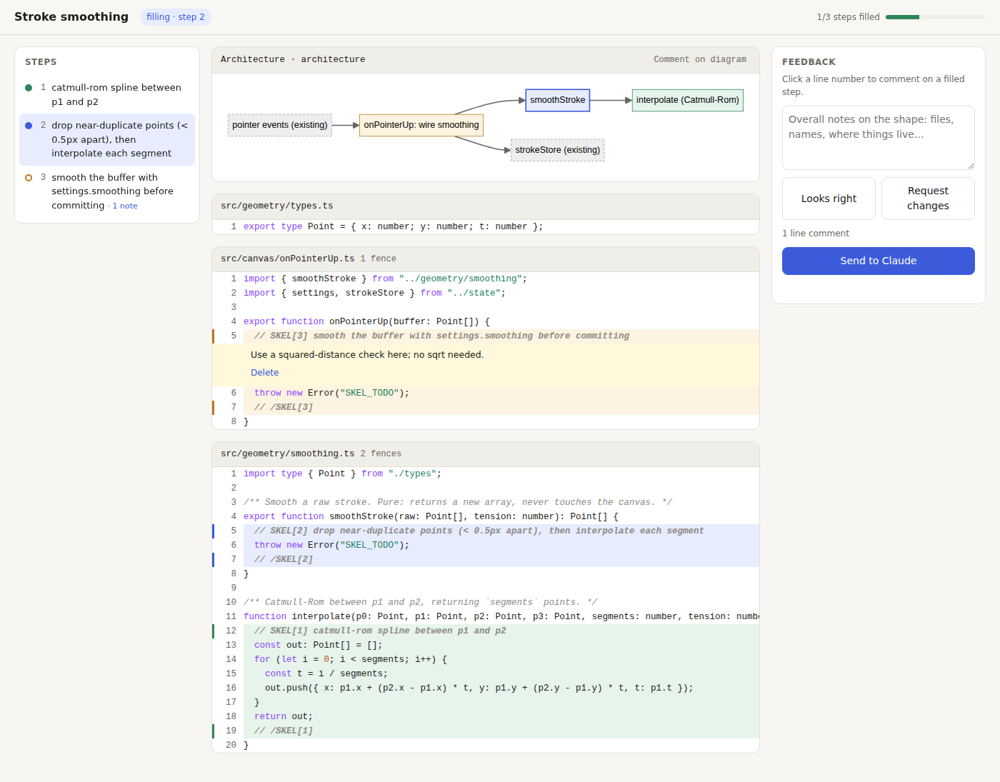

# skeleton-skills

**Write the plan as code. Review the plan's shape. Then fill it in one fenced step at a time.**

Two Claude Code skills and a small CLI that bring back the feeling of building with an AI pair one function at a time, with strong opinions about where code lives:

1. **`/skeleton`**: Claude writes the feature as a *skeleton*: real files, real types and signatures, real wiring, plus an architecture diagram. Every body is an empty, fenced stub. You review the skeleton in a local page, comment on lines or on the diagram, and approve.
2. **`/skeleton-fill`**: Claude fills one step at a time (or `all` of them), but **only inside the fences**. Each step's code is written by a restricted `skeleton-filler` subagent with no shell and no Write, and a `PreToolUse` hook checks every edit, so a signature change or a new file can't slip in unasked: it comes back to you as a skeleton change.



## Why

A prose plan says what will happen. A skeleton *is* what will happen: the file layout, the names, what calls what, what's pure and what has side effects. Most architecture mistakes from an agent happen at exactly that level, and in a skeleton they're cheap to fix because there's no logic to throw away yet. Once you've approved the shape, each fill is a 5–30 line diff inside a slot you designed, small enough to actually read.

## Markers

```ts
/** Smooth a raw stroke. Pure: no canvas access. */
export function smoothStroke(raw: Point[], tension: number): Point[] {
  // SKEL[2] drop near-duplicate points (< 0.5px apart), then interpolate()
  throw new Error("SKEL_TODO");
  // /SKEL[2]
}
```

- `SKEL[id] <title>` opens a fence and `/SKEL[id]` closes it. Each marker is on its own line, behind any comment prefix (`//`, `#`, `--`, `<!--`, …).
- A fence whose body contains `SKEL_TODO` is pending; otherwise it's filled. Progress is read from the code, so there's no status file to drift out of date.
- One id can fence several places (an implementation and its test).
- Ids sort naturally (`1`, `2`, `2.1`, `10`) and set the build order.
- The scan (and the gate) skip tool and build directories wherever they appear: `node_modules`, `.git`, `.claude`, `.skeleton`, `dist`, `build`, `out`, `coverage`, `target` and friends. Fences under a directory with one of those names are ignored, so keep skeleton code elsewhere.

## Architecture diagrams

Mermaid files in `.skeleton/diagrams/*.mmd` render above the code. Nodes with the id `step_<id>` (`step_2_1` for step `2.1`) are colored by status (pending, filled, active), and clicking one jumps to its fence. You can comment on a diagram as a whole.

## Install

```bash
git clone https://github.com/mitchjablonski/skeleton-skills
node skeleton-skills/bin/skel.mjs install /path/to/your/project
```

This copies the two skills into `<project>/.claude/skills/`, the `skeleton-filler` subagent into `<project>/.claude/agents/`, and adds the scope-gate hook to `<project>/.claude/settings.local.json`. Running it again updates them in place. If `.claude/agents/` didn't exist when your Claude Code session started, restart the session so it picks up the subagent.

## The loop

```
/skeleton add stroke smoothing to the canvas
   → skel init, writes stubs + diagram, `skel serve` → review URL
   → you comment / request changes / approve in the page
   → skel feedback --wait 110   (Claude picks up your feedback)
   → skel approve               (Claude Code asks you to allow it)
/skeleton-fill            (one step, then stop)
/skeleton-fill all        (every step, still fenced)
   → skel next → your opinion → skeleton-filler edits inside the fence → tests → skel done → skel feedback
   → a structural change? Claude stops and proposes it → you reopen it → skel reshape → re-review
   → skel finalize          (strips the markers)
```

## CLI

| Command | |
|---|---|
| `skel init "<title>" [--gate ask\|deny] [--force]` | Start a skeleton (`.skeleton/state.json`); won't replace one in progress without `--force` |
| `skel track <file…>` | Include unfenced skeleton files (e.g. new types) in the review; must be inside the project |
| `skel status [--json]` | Phase, active step, each step's status, and diagram nodes that match no step |
| `skel serve [--port N] [--stop]` | Live review page; feedback is sent back to Claude. Reuses a running server; uses a stable port per project, so unsent drafts survive a restart |
| `skel review` | Static `.skeleton/review.html`; copy the feedback by hand |
| `skel feedback [--wait S]` | Print and archive the human's feedback (waits up to 110s; prints `NO_FEEDBACK` otherwise) |
| `skel approve` | Enter the fill phase. When Claude runs it, the hook asks you to allow it: that prompt is your approval |
| `skel reshape` | Back to skeleton review (also asks you) |
| `skel next` / `skel start <id> [--force]` / `skel done` | Run steps. `--force` abandons an unfinished step or reopens a filled one |
| `skel finalize` | All filled: strip the markers |
| `skel hook` | The `PreToolUse` scope gate |

**Gate modes:** `ask` (default) sends an out-of-fence edit to you for a yes or no. `deny` refuses it outright, so Claude must propose a skeleton change.

## The filler subagent

`/skeleton-fill` splits each step in two. The main conversation runs the loop: `skel serve`, `skel next`, your opinion on the approach, the tests, `skel done` and `skel feedback`. The code edit goes to `skeleton-filler`, a [Claude Code subagent](https://code.claude.com/docs/en/sub-agents) whose `tools` are only `Read, Grep, Glob, Edit, MultiEdit`, with `Bash`, `PowerShell`, `Monitor`, `Write`, `NotebookEdit` and `Agent` also denied. The main conversation hands it the fence bodies from `skel next`, the step's contract, the agreed approach and the test to satisfy. The filler edits inside the fence and returns a short report: `filled`, or `blocked` with the skeleton change it needs. It can't run the tests, so when they fail the main conversation sends the output back to it.

**Why:** the hook can only pattern-match shell commands, so arbitrary Bash is the hole in the fence. The agent that writes the step's code has no shell, so for that agent every change goes through Edit, where the hook judges the result exactly. It also can't create a file without you allowing it (Write is removed, and an Edit that would create a file goes to you), can't spawn agents, and starts without your conversation, only with the step's brief.

**Trade-offs:**
- An extra subagent hop per step: a little more latency and tokens, and the filler re-reads the code around the fence.
- The filler can't run anything. It can't check its own work, so a failing test is a round trip, not a quick local fix.
- The main conversation still has a shell, and the skill asks it not to write fence code itself. That rule is an instruction, not something the hook enforces. The filler narrows who writes the code; it doesn't take the shell away from the session.
- MultiEdit is a legacy tool name in current Claude Code (Edit covers it). It's listed for older versions; Claude Code only refuses a subagent when *no* entry in its `tools` resolves.

## Security model

The fence is a **drift guard for a cooperative agent**: it keeps an agent that means well from quietly widening its own scope. It is not a sandbox against a hostile one, which could always write files from a shell.

- **Your approval is Claude Code's permission prompt.** The hook always asks before `skel approve`, `skel reshape`, `skel init --force` or `skel finalize` runs, and before `git clean -x`/`-X` or `git stash -a`/`--all` (which would delete `.skeleton/`), even in `deny` mode. That prompt is the one channel the agent can't answer for you. It fires from any working directory and for the common spellings (quoted, a path in a variable, `xargs`); it's a word match, not a shell parser. Review-page verdicts and feedback files are only signals to the agent; anything on disk or on a local port can be forged from a shell, so none of it counts as approval. How the prompt behaves follows Claude Code's permission mode: you see it in the default, `acceptEdits`, `plan` and `auto` modes; a non-interactive run with no one to answer refuses the command; and `bypassPermissions` skips it.
- **Edits are judged by their result.** During a fill, an Edit, MultiEdit (applied in order) or Write is allowed only if the SKEL markers come out identical, every line outside the active fence is unchanged, and the filled body stays inside its block. Line endings are compared as LF (Claude Code's Edit matches CRLF files that way), and an edit whose `old_string` can't be located asks. The block check is a language-aware heuristic, not a parser, so a hit always asks rather than refuses.
- **Between steps,** edits to fenced or tracked files, and new files, ask. NotebookEdit asks during a fill.
- **The tool's state is off-limits.** Agent edits to any `.skeleton/` directory, at any depth (except the top-level `diagrams/`), ask, matched case-insensitively. So do Bash commands that name `.skeleton/` state, from any working directory. **Nested skeletons:** the outermost skeleton that is mid-fill wins. While it is filling, the hook ignores any skeleton nested inside it: edits there are judged against the outer skeleton's active step (so they ask), and a state file planted or shipped deeper down can't take over the fence. When no enclosing skeleton is mid-fill, the nearest one applies. The `skel` CLI always uses the nearest one, so finalize (or reshape) the outer skeleton before working on a nested one.
- **The review server** binds to 127.0.0.1, answers only requests addressed to `127.0.0.1`/`localhost` (no DNS rebinding), and accepts feedback only same-origin, as JSON, with a per-run token. So other websites can't post to it. The markdown Claude reads is rebuilt server-side and framed as review notes, not instructions.
- **Feedback is tied to this skeleton's serve runs**, whose ids live outside the project (`~/.config/skel/`), so nothing committed to a repo can vouch for a feedback file. Leftover, committed or hand-written ones are quarantined. `init` stops the old review server and forgets its sessions; a superseded server refuses sends. `skel serve` reuses a running server only after it answers with the id it recorded, and never kills a bare pid. `install` adds `.skeleton/` to `.gitignore`. If the session store can't be written, `serve` warns and keeps serving the page, but refuses sends from it (they couldn't be trusted). Feedback left unread by a pre-upgrade `skel serve` (which kept its session ids in `.skeleton/serve.json`) is quarantined, not migrated: a committed `serve.json` looks the same as a real one, so trusting it would let a repo vouch for its own feedback again. `serve` and `feedback` warn about it; re-send it from the page.
- **Files:** tracked files must resolve inside the project; writes go through temp-file-and-rename (never through a symlink); `install` refuses symlinked or unparseable settings rather than overwrite them, and refuses a symlinked `.claude/skills/` or `.claude/agents/` folder or installed skill or agent file.
- **Mermaid** is pinned to a patched release (past CVE-2025-54881) with Subresource Integrity, and loads without blocking the page.

Not covered: arbitrary Bash in the main conversation (the filler subagent that writes each step's code has none), and anything once a hook fault makes it fail open. Pair it with Claude Code's permission rules if you need hard limits.

## Prior art

[pi-topdown-kit](https://github.com/yinloo-ola/pi-topdown-kit) does scaffold-first stepwise refinement for the pi harness: a compilable skeleton of `stub()` calls, with progress read by grep. skeleton-skills brings the idea to Claude Code and adds fences enforced by a hook, a review page with comments that go back to Claude, and diagrams that track step status.

## Development

```bash
npm test     # node --test, no dependencies
```

MIT
